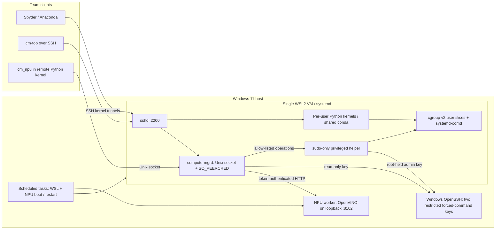

# workstation-commons

**One Windows workstation. A shared Python compute server for your team.**


Turn **one Windows 11 workstation running WSL2 + systemd** into a shared
multi-user compute server for **3–5 people using Spyder / Anaconda**.
Keep the familiar desktop IDE; share the workstation's CPU, RAM, GPU and Intel NPU.

### Meet `cm-top`
Console overview, cleaned from the [80×24 design mock](design/tui/frames/console-overview--normal--80x24.mock).
Names and workload figures are illustrative, not deployment defaults.

```text
  cm-top SERVER  up 1h 03m                                       oomd ✓  admin
 1 Overview  2 Users  3 Kernels  4 Policy  5 HW  6 WSL  7 Envs  8 Hist  9 Audit
╭─ Memory budget ──────────────────────────────────────────────────────────────╮
│                                                                              │
│ ██████████████████████████████████████████████░░░░░░░░░░░░░░░░░░░░░░░░░░░░░░ │
│ └─────────────────────────────────────────────┘                              │
│ guaranteed 4 x 16G = 64G of 104G                                               │
│ demo 0.0G  alice 41.2G  bob 18.5G  carol 2.1G  free 42.2G                       │
╰──────────────────────────────────────────────────────────────────────────────╯
╭─ Needs attention (3) ─────────────────────────────────────────────────────────╮
│   WHAT                                                                WHEN   │
│ ▲ alice above guarantee (41.2G)                                        now    │
│ i bob kernel idle 40m, 18.2G held                                       40m    │
│ ✓ policy applied to 4 users                                            2m     │
│                                                                              │
│                                                                              │
│                                                                              │
│                                                                              │
│                                                                              │
│                                                                              │
│                                                                              │
╰──────────────────────────────────────────────────────────────────────────────╯
 ✓ policy applied to 4 users · 2m ago
 ↑↓ select  enter open  1-9 page  F1-3 layout                    ? help  q quit
```

[Admin setup](#quick-start-for-admins) · [User setup](#quick-start-for-users) ·
[Configuration](#configuration-reference) · [API contract](docs/API.md)

## Why
- **Share the machine, not an account.** Separate Linux users, SSH keys and home directories.
- **Keep Spyder.** Run code remotely without replacing the team's Anaconda workflow.
- **Make contention visible and manageable.** Memory policy, fair CPU sharing and a terminal control panel.

## Features
| Capability | What you get |
|---|---|
| Memory policy | Per-user `MemoryLow` guarantee/protection and `MemoryHigh` soft cap; aggregate `user.slice` `MemoryMax` hard cap through systemd cgroup v2 + systemd-oomd. |
| Fair CPU | Equal configurable `CPUWeight` for user slices; idle capacity remains usable. |
| Unlimited GPU access | Shared CUDA GPU with no project-enforced per-user quota or partition; physical VRAM is still finite. |
| Shared conda environments | `sci`, `sci-spyder5`, `sci-legacy` for Spyder **3.2.8 through 6**; CUDA PyTorch/CuPy and a full DS/ML stack installer. |
| Remote Spyder kernels | `spyder-kernel <env>`, SSH tunnels and lingering user sessions. |
| Intel NPU queue | `cm_npu` submits OpenVINO models to a Windows worker: one active job, fair round-robin across users, FIFO within each user. |
| `cm-top` TUI | Three switchable layouts (**F1–F3**): Console, Dashboard, Budget; nine pages, btop-style hardware view, ANSI-16 theme-following, `NO_COLOR`, **80×24 minimum**. |
| Administration | `computeadmin` group roles, user/key management, policy editing, kernel stopping and WSL controls. |
| Observability | Live updates, 30-day SQLite metric history and privileged-operation JSONL audit log. |
| Boot without login | Windows scheduled tasks keep WSL and the NPU worker running under the designated owner. |

The nine pages are **Overview · Users · Kernels · Policy · Hardware · WSL · Envs · History · Audit**.
Regular users see their own user/kernel data and no administrative pages.
The DS/ML installer includes pandas/Polars, SciPy, scikit-learn, XGBoost/LightGBM/CatBoost,
PyTorch, Transformers, ONNX Runtime, OpenVINO, plotting, Dask and experiment tooling.

## Architecture


## Security model
- **Socket-only management API:** `compute-mgrd` runs as unprivileged `computemgr`,
  listening on `/run/compute-mgr/api.sock`, not TCP. No web UI or API login tokens.
- **Kernel-verified identity:** `SO_PEERCRED` supplies the caller UID. Membership in
  `sudo` or `computeadmin` grants admin; `compute` grants user access. Roles are
  resolved per request; user-specific endpoints are scoped to the caller.
  The socket is mode `0666`; authorization is enforced by the daemon, not socket secrecy.
- **Small privileged boundary:** only `computemgr` has the installed sudo rule for
  the helper. The daemon authorizes operations; the helper allow-lists operations,
  validates arguments/protected accounts, checks kernel ownership and records mutations
  in `/var/log/compute-mgr/audit.jsonl`. See [helper contract](docs/HELPER.md).
- **No Windows escape through interop:** install `deploy/wsl.conf` to disable WSL
  interop, Windows PATH injection and drive automount, including `C:`.
- **Restricted Windows administration:** host facts and WSL administration use only
  two forced-command SSH keys, with no PTY or forwarding. The info key is available
  to the daemon; the admin key stays root-only. The NPU data path is separate:
  loopback HTTP with a worker token held by the daemon, not compute users.

This is a trusted small-team server, not a sandbox for hostile tenants.

## Quick start for admins

> **Deployment scripts are provisioning pieces, not a turnkey installer.** Review
> their machine-specific assumptions first. Commands below are setup instructions;
> package-installing scripts require network access when you deploy them.

1. **Prepare the owner and host.** Choose the Windows account `<owner>` that owns
   the WSL distribution. Install WSL2, an Ubuntu/systemd distribution, Windows OpenSSH
   Server, the NVIDIA Windows CUDA-capable driver and, for NPU use, Intel's NPU driver
   and Python 3.12 at the path expected by `npu/worker/install-worker.ps1`.
   Copy the repository to both Windows and the Linux filesystem.

2. **Configure Windows / WSL networking and boot.** Adapt `deploy/wslconfig.txt`
   to the machine's RAM/cores, then place it at `%USERPROFILE%\.wslconfig`.
   Review `deploy/setup-win.ps1` before running it elevated: it reads
   `$HOME\wslconfig.txt`, targets `Ubuntu-24.04`, creates `WSL-Autostart`, and its
   firewall rule currently says **2222**, whereas Linux uses **2200**. Reconcile
   those settings and restrict inbound TCP 2200 to your trusted LAN/VPN.
   For an existing `C:\wsl\compute\ext4.vhdx`, instead use
   `winhost/setup-as-owner.ps1` as the owner; it imports `compute` and creates
   `cm-compute-autostart`. Do not register two competing WSL boot tasks.
   The host-info script currently checks `WSL-Autostart`, so the alternative task
   name can appear missing in the UI even while the VM is running.

3. **Bootstrap Linux and the shared environments.** From the repository in WSL:

   ```bash
   sudo env ADMIN_PUBKEY_FILE=/path/to/admin.pub bash deploy/setup-linux.sh
   sudo install -m644 deploy/wsl.conf /etc/wsl.conf
   sudo bash deploy/envs.sh
   sudo bash deploy/envs3.sh
   sudo bash deploy/install-ds-stack.sh
   ```

   The bootstrap creates an `admin` account with passwordless sudo. Use a trusted
   administrator's public key. If Ubuntu socket activation still binds the wrong
   port, `sudo bash deploy/fixssh.sh` installs a 2200 socket override.
   Restart WSL from Windows to apply `wsl.conf`; finish any Windows-drive transfers
   first. The repository must remain accessible on the Linux filesystem.

4. **Install the manager and TUI.** Build the binary first; the installer only
   copies `tui/cm-top` if it already exists:

   ```bash
   (cd tui && cargo build --release)
   install -m755 tui/target/release/cm-top tui/cm-top
   sudo bash deploy/install-compute-mgr.sh
   ```

   Create root-owned `/etc/compute-mgr/site.conf` (replace both placeholders):

   ```ini
   OWNER=<linux-owner>
   CM_WIN_TARGET=<owner>@127.0.0.1
   ```

   `OWNER` protects Linux accounts from helper user-management operations; it is
   not the Windows task owner. The bootstrap Linux administrator is named `admin`.

5. **Provision the Windows bridges.** In elevated PowerShell under the owner,
   run `npu/worker/install-worker.ps1` and `winhost/install-winhost.ps1`.
   The latter contains deployment-specific public keys: replace those authorized
   entries with your own two keys while retaining the forced commands and restrictions.
   Securely provision matching private keys in WSL as `/etc/compute-mgr/win-info`
   (`computemgr`, mode `0600`) and `win-admin` (`root`, mode `0600`). Pin the verified
   Windows SSH host key in `/etc/compute-mgr/known_hosts`.
   Securely copy `C:\cm-npu\token` to `/etc/compute-mgr/npu.token`, readable only by
   `computemgr` (and root). Never share these credentials with compute users.

6. **Apply resource policy and verify.** Ensure `systemd-oomd` is installed and active.
   Restart `compute-mgrd`, log in as `admin`, and open `cm-top`:

   ```bash
   sudo systemctl enable --now systemd-oomd
   sudo systemctl restart compute-mgrd
   ssh -t -p 2200 admin@192.168.1.10 cm-top
   ```

   On **Policy**, press `e` and set an appropriate guarantee, soft cap, total cap
   and CPU weight. This replaces the bootstrap's older **28G hard cap / 24G high /
   16-core quota** configuration; restart WSL afterward to clear old limits on existing slices. Keep aggregate
   guarantees within the total cap and reserve RAM for the OS/services.
   Check hardware, kernels and NPU status, then test a reboot without interactive login.

## Quick start for users

1. Generate an SSH key locally with `ssh-keygen -t ed25519` and send **only the
   public `.pub` file** to your administrator. They create your compute account.
2. Start a remote kernel using the environment matching your local Spyder:

   | Server environment | Python | Local Spyder / kernel protocol |
   |---|---|---|
   | `sci` | 3.12 | Spyder 6.x / `spyder-kernels` 3.1 |
   | `sci-spyder5` | 3.11 | Spyder 5.x / `spyder-kernels` 2.5 |
   | `sci-legacy` | 3.11 | Spyder 3.2.x (including 3.2.8) / plain `ipykernel` |

   ```bash
   ssh -p 2200 alice@192.168.1.10 spyder-kernel sci
   scp -P 2200 alice@192.168.1.10:/path/printed/kernel-sci-NNN.json .
   ```

3. In Spyder, choose **Consoles → Connect to an existing kernel**, select the JSON,
   enable **remote kernel via SSH**, and use `alice@192.168.1.10:2200` with your
   private key. In `cm-top`, the Kernels page's `c` popup also shows connection help.
   Files are on the server: use `~/data`. Kernels survive logout; stop unused ones
   from Spyder or with `s` on the Kernels page.

### Use the Intel NPU from a remote kernel

`cm_npu` is installed into the shared environments. Run this **on the server**:

```python
import numpy as np
import openvino as ov
from openvino import opset13 as ops
import cm_npu

x = ops.parameter([1, 16], np.float16, name="x")
model = ov.Model([ops.relu(x)], [x])
outputs = cm_npu.run(model, {"x": np.ones((1, 16), dtype=np.float16)})
print(outputs)
print(cm_npu.last_timing)
print(cm_npu.status())
```

Model/operator support depends on the NPU driver and OpenVINO. Use `device="CPU"`
or `device="GPU.0"` for comparison (the latter is the Intel iGPU, not NVIDIA CUDA).
Defaults allow four queued jobs per user and a 300-second queue wait.

## Managing users

On `cm-top`'s **Users** page (admin only):

| Key | Action |
|---|---|
| `a` | Add a user with their SSH public key; enables linger. |
| `d` | Disable the selected account, terminate sessions, retain its home. |
| `A` | Toggle membership in `computeadmin` after confirmation. |
| `Enter` | Open SSH keys; `a` adds a key, `x` removes one. |

`computeadmin` grants manager privileges, **not general sudo**. `sudo` members are
also manager admins. Roles take effect on the next API request.

CLI alternative, run **as an authorized Linux admin**, not an arbitrary root shell:

```bash
curl --unix-socket /run/compute-mgr/api.sock http://localhost/api/v1/users
curl --unix-socket /run/compute-mgr/api.sock -X PUT \
  -H 'Content-Type: application/json' -d '{"role":"admin"}' \
  http://localhost/api/v1/users/alice/role
```

See [API.md](docs/API.md) for add/disable/key/policy calls. The older
`deploy/tools.sh` installs `compute-adduser`, `compute-users` and `compute-dash`,
but also creates a `demo` user using the admin key; do not run it blindly.
Prefer the audited manager API for routine administration.

## Configuration reference
| Location / key | Purpose / default |
|---|---|
| `/etc/compute-mgr/site.conf`: `OWNER` | Protected Linux owner accounts, comma/space separated. |
| Same: `CM_WIN_TARGET` | Windows SSH target; set `<owner>@127.0.0.1` explicitly. |
| `CM_SOCK` | Daemon/TUI socket; `/run/compute-mgr/api.sock`. |
| `CM_API_SOCK` | Python `cm_npu` client socket; same default. |
| `CM_DB` | History DB; `/var/lib/compute-mgr/metrics.db`. |
| `CM_WIN_INFO_KEY`, `CM_WIN_KNOWN_HOSTS` | Info key / pinned host keys; `/etc/compute-mgr/win-info`, `/etc/compute-mgr/known_hosts`. Helper admin paths are fixed. |
| `CM_NPU_URL`, `CM_NPU_TOKEN_FILE` (daemon) | `http://127.0.0.1:8102`, `/etc/compute-mgr/npu.token`. |
| `CM_NPU_MAX_QUEUED`, `CM_NPU_WAIT_TIMEOUT`, `CM_NPU_RUN_TIMEOUT` | `4` per user, `300` seconds waiting, `600` seconds worker HTTP timeout. |
| `CM_NPU_PORT`, `CM_NPU_TOKEN_FILE`, `CM_NPU_CACHE`, `CM_NPU_LOGS` (Windows worker) | `8102`, `C:\cm-npu\token`, `C:\cm-npu\cache`, `C:\cm-npu\logs`. |
| `/etc/compute-mgr/tui.toml` | `[connect]` with `hosts = ["192.168.1.10"]`; fallback `localhost`. |
| `~/.config/cm-top/state.toml` | Persisted `layout = "console"`, `"dashboard"` or `"budget"`. |
| `user-.slice.d/50-limits.conf`, `user.slice.d/50-total.conf` under `/etc/systemd/system/` | Helper-managed per-user and aggregate policy; edit through the Policy page/API. |
| Windows `%USERPROFILE%\.wslconfig` | VM memory/processors/swap/networking; edits require WSL restart. |
| `/etc/wsl.conf` | systemd enabled; interop and automount disabled. |

## Limitations
- **WSL cannot reliably attribute GPU memory per user.** Unavailable metrics are
  `null`/`n/a`; GPU-active detection is a device-handle heuristic, not accounting.
- **NPU models need static shapes; use FP16-compatible models/operators.** The
  client does not automatically convert every model to FP16 or guarantee NPU support.
- **One shared WSL VM under one Windows owner.** WSL registrations are per Windows
  user; logging in as another Windows user does not expose the owner's distribution.
- `MemoryLow` is reclaim protection, not a preallocated reservation; `MemoryHigh`
  is a soft threshold. systemd-oomd may terminate workloads under sustained pressure.
- WSL restart disconnects everyone and stops kernels. Boot task names, firewall
  ports, hardware-sized limits and bridge credentials require site-specific setup.

## Project layout
```text
workstation-commons/
├── backend/          # FastAPI daemon, peer credentials, metrics, NPU scheduler, tests
├── helper/           # Root-only operation implementation via sudo
├── tui/              # Rust / ratatui cm-top, fixtures and tests
├── npu/
│   ├── client/       # cm_npu Python client
│   └── worker/       # Windows OpenVINO worker and installer
├── winhost/          # Forced-command host scripts and owner boot-task setup
├── deploy/           # Linux/Windows provisioning, environments, sudoers, WSL config
├── docs/             # API and helper contracts
└── design/tui/       # Design system and text/ANSI mock frames
```

## Development

With Python 3.12+, `uv` and a Rust toolchain:

```bash
cd backend
uv run pytest
cd ../tui
cargo test
cargo run -- --mock fixtures --frame console:overview
# With cm-top built/installed, from tui/:
cm-top --mock fixtures --frame console:overview
```

Mock frames render without a running daemon or workstation hardware. API changes
must stay aligned with [docs/API.md](docs/API.md) and both clients.

## License
MIT.
