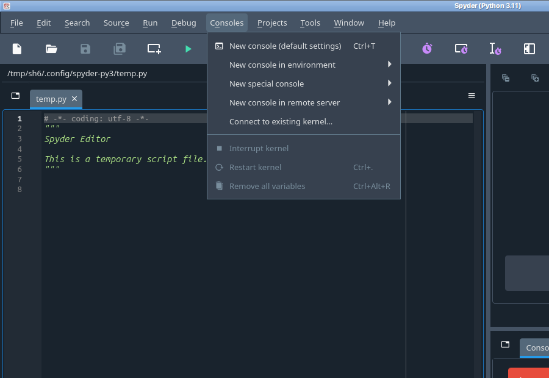
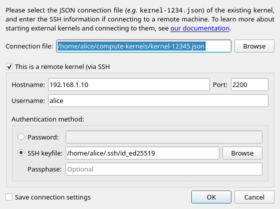
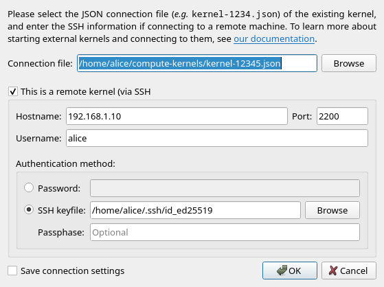
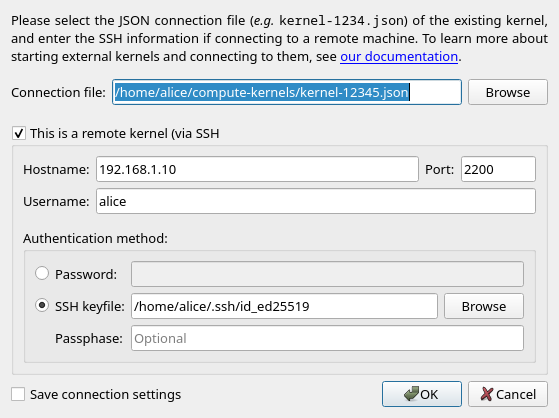
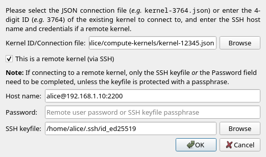

# Compute Server — User Guide

For people who have (or want) an account on the shared compute server. You run Python on the server's CPUs, GPU and NPU from your own laptop. You can use Spyder, VS Code, PyCharm, Zed or a plain terminal.

| | |
|---|---|
| Lab network (LAN) address | `192.168.1.10`, port **2200** |
| Remote address (Tailscale) | `<tailscale-ip>`, port **2200** |
| Login | SSH key only. There are no passwords. |
| Hardware | 24-core Intel Core Ultra 9 285K, about 110 GB RAM, NVIDIA RTX 5080 (16 GB), Intel NPU |

> Each time you log in, you see an info card. The **yellow lines** on it show your own connect, copy and Spyder commands. Run `cm-info` to show the card again.

---

## 1. Get an account (one time)

1. Open a terminal: PowerShell on Windows, Terminal on macOS or Linux.
2. Create a key if you don't have one yet (`ls ~/.ssh` shows `id_ed25519.pub`):
   ```
   ssh-keygen -t ed25519
   ```
   Press Enter to accept the default file. A passphrase is recommended.
3. Print your **public** key and send this one line to the admin:
   ```
   cat ~/.ssh/id_ed25519.pub
   ```
   Never send `id_ed25519`, the file without `.pub`. That is your private key, and nobody needs it.
4. The admin replies with your account name.

**How keys work:** the server keeps your public key, and your private key stays on your laptop. When you log in, the server sends a challenge. Only the private key can sign it, and the server checks the signature with the public key. The private key never leaves your machine.

## 2. Connect from outside the lab: Tailscale

On the lab network, use `192.168.1.10`. From anywhere else, you need **Tailscale**, a private VPN. With it, the server is reachable at `<tailscale-ip>`.

1. Install Tailscale from https://tailscale.com/download and sign in.
2. Join the server's network in one of two ways. The admin tells you which one applies to you:
   - **Invited to the lab tailnet:** accept the email invite. The server then appears in your device list.
   - **Machine shared with you:** open the share link the admin sent, then click **Accept**. Only the server is shared. You see nothing else, and the lab sees none of your devices.
3. Check:
   ```
   tailscale status | grep <tailscale-ip>     # server is listed
   tailscale ping <tailscale-ip>              # "pong from ..."
   ```
4. Use `<tailscale-ip>` wherever this guide says `192.168.1.10`.

Tailscale only needs to be running while you connect. Your own internet traffic does not go through the lab.

## 3. Set up a shortcut and log in

Add this to `~/.ssh/config`. On Windows the file is `%USERPROFILE%\.ssh\config`.

```
Host compute
    HostName 192.168.1.10
    Port 2200
    User <account>
    IdentityFile ~/.ssh/id_ed25519
    IdentitiesOnly yes

Host compute-remote
    HostName <tailscale-ip>
    Port 2200
    User <account>
    IdentityFile ~/.ssh/id_ed25519
    IdentitiesOnly yes
```

Then run `ssh compute` (or `ssh compute-remote`). Type `yes` the first time. You are connected when you see the info card and `<account>@SERVER:~$`.

**Port 2200 matters.** If you leave it out, you reach the Windows host instead and get `Permission denied`.

## 4. Hardware and fair-share rules

| Resource | Rule |
|---|---|
| CPU (24 cores) | Remote users together can use up to **18 cores**; 25% is reserved for the person at the server. When nobody else is computing, you can use all 18; when others are, the CPU is shared evenly. |
| Memory | Each person gets **24 GB guaranteed** and a **soft limit of 72 GB**, above which your work is slowed. All users together are capped at 88 GB. |
| GPU (RTX 5080, 16 GB) | Each process may use up to **75% of VRAM** (about 12 GB). Override with `CM_GPU_FRACTION=1`, but only when the GPU is free. Free your VRAM when you are done. |
| NPU | Runs from a queue, one job at a time, taking turns between users. Up to 4 queued jobs per person. |
| Disk | `~/` holds your code. `~/data` is your private folder for datasets. |

Run `cm-top` at any time to see your usage, your kernels and the hardware status.

## 5. Python environments

| Env | Python | Use |
|---|---|---|
| `sci` | 3.12 | Main environment. Use it with Spyder 6.1, VS Code, PyCharm and Zed. |
| `sci-spyder5` | 3.11 | Spyder 5.5 |
| `sci-legacy` | 3.11 | Spyder 3.2, and the base for the other old kernels |

These come preinstalled: numpy, scipy, pandas, polars, matplotlib, scikit-learn, statsmodels, xgboost, lightgbm, PyTorch (CUDA), cupy, transformers, OpenVINO, opencv and more.

To add your own packages on top of the shared ones (uses only a few MB):

```bash
/opt/conda/envs/sci/bin/python -m venv --system-site-packages ~/venvs/mywork
~/venvs/mywork/bin/pip install <package>
```

## 6. Connect Spyder

Spyder runs on your laptop and the **kernel runs on the server**. Each Spyder version only works with matching kernels, so tell the server which version you use. You can check it under **Help → About Spyder**.

| Your Spyder | Command on server |
|---|---|
| 6.1.x | `spyder-kernel 6.1` |
| 6.0.x | `spyder-kernel 6.0` |
| 5.0–5.5 | `spyder-kernel 5.5` (or 5.0 … 5.4) |
| 4.0–4.2 | `spyder-kernel 4.2` (or 4.0, 4.1) |
| 3.3 / 3.2 | `spyder-kernel 3.3` / `3.2` |

### Step 1 — start a kernel and download its connection file

```bash
ssh compute spyder-kernel 6.1
# prints:  connection file: /home/<account>/.local/share/jupyter/runtime/kernel-12345.json
scp compute:/home/<account>/.local/share/jupyter/runtime/kernel-12345.json .
```

### Step 2 — open the "connect to existing kernel" dialog

| Version | Menu |
|---|---|
| 6.x | **Consoles → Connect to existing kernel…** |
| 5.x, 4.x | **Consoles → Connect to an existing kernel** |
| 3.x | **Consoles → Connect to an existing kernel** |

### Step 3 — fill in the dialog

**Spyder 4.0 – 6.1**: host, port and username are separate fields:

| Field | Value |
|---|---|
| Connection file | the `.json` you downloaded |
| ☑ This is a remote kernel (via SSH) | checked |
| Hostname | `192.168.1.10` (or `<tailscale-ip>` via Tailscale) |
| Port | `2200` |
| Username | `<account>` |
| Authentication | ◉ SSH keyfile → `~/.ssh/id_ed25519` (private key, stays on your laptop) |
| Passphrase | your key passphrase, or empty |

**Spyder 3.x**: everything goes in one field. Hostname = `<account>@192.168.1.10:2200`, SSH keyfile = `~/.ssh/id_ed25519`, and the Password field holds the key passphrase if you set one.

Spyder 6.1. Open the menu with **Consoles → Connect to existing kernel…**:





**Spyder 5.5** (4.x looks the same):



**Spyder 4.2**



**Spyder 3.3**



### Step 4 — verify

In the new console:
```python
import socket, getpass; socket.gethostname(), getpass.getuser()   # ('SERVER', '<account>')
```

Keep these in mind:
- The kernel keeps running if you close Spyder. Reconnect with the same `.json` and your variables are still there.
- When you're finished, stop the kernel: open `cm-top`, go to the Kernels page, select the kernel and press `s`.
- Spyder has no terminal, but `!cmd` in the console runs on the server, for example `!nvidia-smi`.

### Other editors

| Editor | How |
|---|---|
| VS Code | Install the Remote-SSH extension, run `Remote-SSH: Connect to Host` → `compute`, then set the interpreter to `/opt/conda/envs/sci/bin/python` |
| PyCharm Professional | Settings → Python Interpreter → Add → On SSH → `<account>@192.168.1.10:2200`, key auth, interpreter `/opt/conda/envs/sci/bin/python`. Community edition has no SSH interpreters. |
| Zed | `zed ssh://<account>@192.168.1.10:2200/~/project` |

## 7. Move files

The easiest way is **termscp**, a file browser that runs in the terminal. Install it with:
- macOS: `brew install termscp`
- Windows: `winget install termscp`
- Linux: `cargo install termscp`

```
termscp sftp://<account>@192.168.1.10:2200
```

Your laptop is on the left and the server is on the right. Press `Space` to copy the selected file and `q` to quit.

From the command line:
```bash
scp -P 2200 data.csv <account>@192.168.1.10:~/data/
rsync -av -e "ssh -p 2200" ./project/ <account>@192.168.1.10:~/project/
```

## 8. Compute

| Work | Use |
|---|---|
| pandas, numpy, statistics | CPU |
| Parameter sweeps, repeated simulations | `joblib.Parallel(n_jobs=16)` — 18 cores is the total for all remote users |
| Big matrices, deep learning, FFT | GPU: `torch` with `device="cuda"`, or `cupy` |
| Fixed-shape model inference repeated many times | NPU: `import cm_npu; cm_npu.run(model, inputs)` |

**Threads:** numpy, scipy and torch use **12 threads per process** by default. On this shared CPU that is faster than 24, both alone and when others are busy. If the machine is idle and you want more, run `export CM_THREADS=24` before starting Python. In `joblib` workers, BLAS is limited automatically.

GPU example. Free the memory when you are done:
```python
import torch; x = torch.randn(8192, 8192, device="cuda"); y = x @ x
del x, y; torch.cuda.empty_cache()
```

For jobs longer than a few hours, run them in the background:
```bash
ssh compute
nohup /opt/conda/envs/sci/bin/python ~/project/run.py > ~/project/run.log 2>&1 &
tail -f ~/project/run.log
```

## 9. Troubleshooting

| Message | Fix |
|---|---|
| `Permission denied (publickey)` | Check that you used port 2200. Otherwise the admin has not added your key yet, or ssh is offering a different key. |
| `Connection timed out` | You are off the lab network, so use the Tailscale address and check `tailscale status`. |
| Spyder: `PermissionDenied` / `Authentication failed` | In Spyder 4+, the Port field is not `2200`, or Username is empty. In 3.x, the Hostname field is missing `:2200`. Also check that the Keyfile field points to your key. |
| Spyder: kernel version mismatch | Start the kernel that matches your Spyder version (see §6). |
| `UNPROTECTED PRIVATE KEY FILE` (Windows) | Run `icacls %USERPROFILE%\.ssh\id_ed25519 /inheritance:r /grant:r "%USERNAME%:R"` |

## 10. Etiquette

Stop idle kernels and free GPU memory when you're done. Leave some cores free when others are online. If you lose a laptop, tell the admin at once so they can remove its key.
